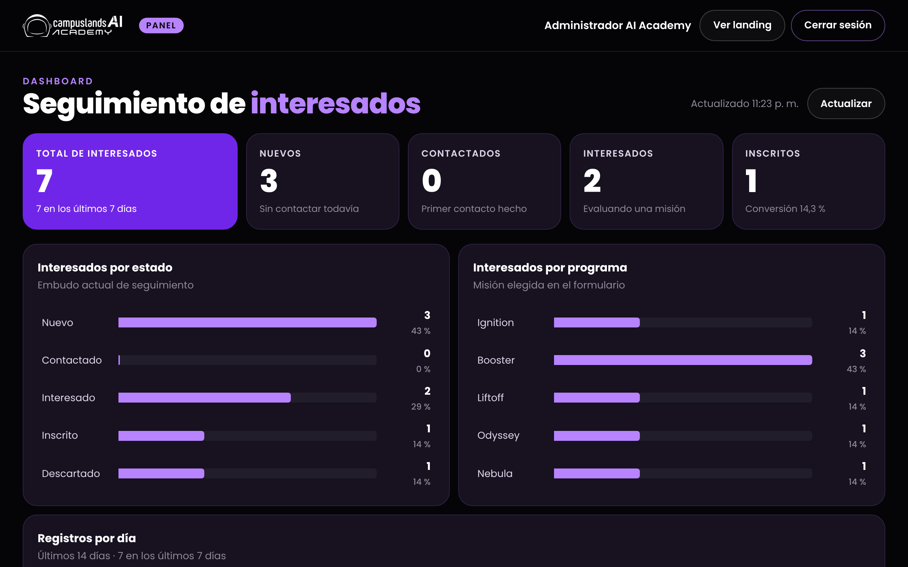

# Campuslands AI Academy · Reto 4

**Automatización de interesados, notificación por Telegram y seguimiento administrativo.**

```
Landing (Astro) → Formulario → Spring Boot → PostgreSQL → n8n → Telegram → Panel /admin/ → Seguimiento
```

Una persona deja sus datos en la landing original de AI Academy. El backend los valida y los guarda en PostgreSQL, abre su historial con el estado `NUEVO` y activa un webhook de n8n. n8n envía el aviso al chat de Telegram del equipo comercial. Desde el panel `/admin/`, el equipo inicia sesión, ve las métricas, busca y filtra interesados, cambia su estado, registra notas y consulta el historial cronológico.

> **Entrega:** [`docs/ENTREGA.md`](docs/ENTREGA.md) reúne los enlaces, el acceso al panel de prueba, cómo ejecutar y cómo verificar cada criterio. Demo en video: [`docs/demo/demo-reto4.mp4`](docs/demo/demo-reto4.mp4) (77 s). Flujo de n8n: [`n8n/workflows/campuslands-nuevo-interesado.json`](n8n/workflows/campuslands-nuevo-interesado.json).



---

## 1. Estado de la entrega

| Funcionalidad | Estado |
|---|---|
| Landing original + formulario integrado (`#inscripcion`), validaciones, indicador de envío, confirmación, control de envíos repetidos | ✅ Implementado y probado (Playwright a 1440 px y 375 px) |
| Todos los botones «Inscríbete», «Elegir misión» y el CTA del recomendador llevan al formulario (y preseleccionan la misión cuando la conocen) | ✅ Implementado y probado |
| API Spring Boot por capas, validaciones, manejo global de errores, JWT + BCrypt | ✅ Implementado y probado (10 pruebas automáticas + `scripts/prueba-e2e.sh`, 33/33) |
| PostgreSQL con Flyway, restricciones e índices; persistencia tras `docker compose down/up` | ✅ Implementado y probado |
| Webhook backend → n8n (con secreto compartido, reintentos y resultado en el historial) | ✅ Implementado y probado con n8n 1.123.5 real en Docker |
| Workflow n8n importado y **activado automáticamente** al arrancar | ✅ Implementado y probado |
| Mensaje de Telegram (formato, `chat_id`, token desde variables de entorno) | ✅ Probado contra un **simulador de la Bot API** (el entorno de pruebas no tenía salida a `api.telegram.org`) |
| Entrega real en un chat de Telegram | ⚠️ Implementado; **necesita tus credenciales** `TELEGRAM_BOT_TOKEN` y `TELEGRAM_CHAT_ID` (ver §10). No se pudo probar con el Telegram real. |
| Panel `/admin/`: login, dashboard, estadísticas, tabla, búsqueda, filtros, detalle, estados, notas, edición e historial | ✅ Implementado y probado contra la API real |
| Varios administradores (sección **Equipo**): cada persona con su cuenta, resumen del «último seguimiento» y responsable en cada paso del historial | ✅ Implementado y probado (otro administrador retoma un caso) |
| Datos ficticios para la demo (`scripts/cargar-datos-demo.sh`) y documento de entrega (`docs/ENTREGA.md`), capturas y video | ✅ |
| Docker Compose: frontend (Nginx), backend, PostgreSQL y n8n con healthchecks, red interna y volúmenes | ✅ Construido y levantado desde cero |

> **Nota sobre los archivos de entrada:** solo se recibió `ai-academy-landing.zip`. El archivo de referencia `GUMI-LEADS.zip` **no llegó adjunto**, así que la automatización se construyó desde cero sobre la landing original, sin tomar nada de ese proyecto.

---

## 2. Arquitectura

```
                         ┌───────────────────────────── red interna Docker: campuslands-red ─────────────────────────────┐
 Navegador               │                                                                                               │
 ─────────               │  ┌──────────────── frontend (Nginx :80) ───────────────┐                                      │
 http://localhost:8080 ──┼─▶│  /          landing Astro (dist/index.html)        │                                      │
                         │  │  /admin/    panel administrativo                    │                                      │
                         │  │  /api/*  ── proxy inverso ──────────────────────────┼──▶ backend (Spring Boot :8080)        │
                         │  └──────────────────────────────────────────────────────┘        │            │               │
                         │                                                                  │ JPA        │ webhook POST  │
                         │                                                                  ▼            ▼ (tras commit) │
                         │                                                    postgres (PostgreSQL 16)  n8n (:5678) ─────┼──▶ api.telegram.org
                         │                                                    volumen postgres_data     volumen n8n_data │      (chat del equipo)
                         └───────────────────────────────────────────────────────────────────────────────────────────────┘
```

**Secuencia de un registro**

1. La landing valida el formulario y hace `POST /api/leads` (mismo origen; Nginx lo pasa al backend).
2. Spring Boot valida de nuevo, normaliza (correo en minúsculas, espacios), verifica duplicados y guarda el lead y su primer registro de seguimiento en **una transacción**.
3. Después del *commit* (`@TransactionalEventListener(AFTER_COMMIT)` + `@Async`), el backend llama al webhook de n8n con el encabezado `X-Webhook-Secret`. La landing ya recibió su `201` y no espera a n8n ni a Telegram.
4. n8n comprueba el secreto, arma el mensaje y llama a `sendMessage` de la Bot API de Telegram con el token y el chat de las variables de entorno.
5. n8n responde `200` (enviado), `502` (Telegram falló) o `401` (secreto inválido). El backend deja ese resultado en el historial del lead con el responsable «Sistema · n8n», así el equipo sabe desde el panel si el aviso salió.

---

## 3. Tecnologías

| Capa | Tecnología |
|---|---|
| Landing y panel | Astro 5, TypeScript sin dependencias de UI, CSS propio (tokens del manual de marca, Poppins) |
| Servidor web | Nginx 1.27 (archivos estáticos + proxy inverso `/api`) |
| Backend | Java 21, Spring Boot 3.5 (Web, Validation, Data JPA, Security, OAuth2 Resource Server para JWT, Actuator) |
| Base de datos | PostgreSQL 16, migraciones con Flyway |
| Automatización | n8n 1.123.5 (Webhook → IF → HTTP Request → Respond to Webhook) |
| Mensajería | Telegram Bot API |
| Contenedores | Docker, Docker Compose |
| Pruebas | JUnit 5, MockMvc, Spring Security Test, H2 (modo PostgreSQL, mismas migraciones), Playwright para la UI |

---

## 4. Estructura de carpetas

```
CAMPUSLANDS-AUTOMATIZACION-RETO4/
├── docker-compose.yml          ← 4 servicios, red interna, volúmenes y healthchecks
├── .env.example                ← todas las variables, opcionales y sin secretos
├── .gitattributes              ← fuerza fin de línea LF en los scripts (clones en Windows)
├── postgres/start-postgres.sh  ← arranque de PostgreSQL + sincronización de la contraseña
├── docs/
│   ├── ENTREGA.md              ← documento para la carpeta de Drive (enlaces, acceso, ejecutar y verificar)
│   ├── demo/demo-reto4.mp4     ← video de la demo (77 s)
│   ├── capturas/               ← capturas de landing, panel, equipo y n8n
│   └── evidencias/             ← avisos generados por n8n (entorno sin Telegram: simulador)
├── scripts/
│   ├── cargar-datos-demo.sh    ← interesados ficticios + seguimiento de dos administradores
│   ├── generar-env.sh          ← crea .env con secretos aleatorios (opcional; Linux/macOS/Git Bash)
│   ├── generar-env.ps1         ← lo mismo para Windows PowerShell
│   └── prueba-e2e.sh           ← prueba de punta a punta contra el stack levantado
├── frontend/                   ← landing ORIGINAL de AI Academy + formulario + panel
│   ├── Dockerfile              ← build con Node 22 → imagen Nginx
│   ├── nginx/default.conf      ← sitio, /admin/, proxy /api → backend, cabeceras de seguridad
│   ├── src/data/content.ts     ← contenido (se añadió INSCRIPCION, API_BASE y LINKS.inscripcion)
│   ├── src/sections/inscripcion.ts   ← NUEVO: sección del formulario
│   ├── src/scripts/lead-form.ts      ← NUEVO: validación y envío real a la API
│   ├── src/pages/admin/index.astro   ← NUEVO: panel /admin/
│   ├── src/scripts/admin/            ← NUEVO: cliente API, lógica del panel, estados
│   ├── src/layouts/Admin.astro       ← NUEVO: layout del panel
│   └── src/styles/admin.css          ← NUEVO: estilos del panel (sobre global.css)
├── backend/                    ← API Spring Boot por capas
│   ├── Dockerfile
│   ├── pom.xml
│   └── src/main/java/co/campuslands/aiacademy/leads/
│       ├── entity/             Lead, Seguimiento, UsuarioAdmin, EstadoLead, Programa
│       ├── dto/                LeadRequest, LeadResponse, StatusUpdateRequest, NoteRequest, ...
│       ├── repository/         LeadRepository (+ Specifications), SeguimientoRepository, UsuarioAdminRepository
│       ├── service/            LeadService, SeguimientoService, DashboardService, AuthService, AdminUserService
│       ├── controller/         LeadController, DashboardController, AuthController, AdminUserController
│       ├── security/           SecurityConfig, JwtConfig, TokenService, LoginAttemptService
│       ├── notification/       LeadRegisteredEvent, N8nLeadNotifier, N8nWebhookClient
│       ├── exception/          GlobalExceptionHandler + excepciones de negocio
│       └── config/             AppProperties, AdminInitializer
│     src/main/resources/db/migration/V1__esquema_inicial.sql
│     src/test/java/...         pruebas de integración
└── n8n/
    ├── workflows/campuslands-nuevo-interesado.json   ← workflow exportado
    ├── start-n8n.sh            ← resuelve la clave de cifrado, importa y activa el workflow
    └── publicar-workflow.cjs   ← publica la versión importada (requisito de n8n 1.12x)
```

### Cambios hechos sobre la landing original

Se conservaron el diseño, los colores negro y violeta, Poppins, los logos, a Max, las imágenes, las siete etapas del recorrido, las animaciones y el diseño responsive. No se eliminó ninguna sección. Los cambios son estos:

- **Nueva sección `#inscripcion`** dentro de la etapa «Llegada», antes del bloque CTA final. Usa los mismos recursos de marca (píldora, titular con una palabra destacada, pasos en Evox Purple, tarjeta al 10 % de violeta y Max con el visor «idea», una pose aprobada que la landing no estaba usando).
- `LINKS.inscripcion` ahora es `#inscripcion`. Los 11 enlaces de inscripción (menú, menú móvil, barra móvil, comparador, recomendador, cierre y pie) ya no abren el sitio externo: llevan al formulario. «Elegir Booster» y el CTA del recomendador **preseleccionan la misión**.
- `astro.config.mjs`: proxy de `/api` para `npm run dev`.
- `global.css`: se añadió al final un bloque «Reto 4» con los estilos del formulario. No se modificaron los estilos existentes.
- Corrección menor: los `<button class="btn--outline">` heredaban el fondo gris del navegador; ahora son transparentes como los enlaces.

---

## 5. Inicio rápido con Docker

Requisitos: **Docker Desktop abierto y en estado «Running»** (o Docker Engine con el plugin Compose v2), con unos 4 GB de RAM asignados. No hace falta Java, Node ni PostgreSQL en tu equipo. Si Docker no responde, mira el §15.

**El proyecto arranca sin configurar nada**: no necesitas crear `.env` para la primera prueba.

```bash
# 1. Desde la carpeta del proyecto: construir y levantar todo
#    (la primera vez descarga imágenes y dependencias: de 3 a 8 minutos)
docker compose up -d --build

# 2. Ver el estado: espera a que los 4 servicios digan "healthy"
docker compose ps

# 3. Contraseña del panel (se genera en el primer arranque y se muestra una sola vez)
docker compose logs backend | grep -A3 CONTRASE
#    Windows PowerShell:  docker compose logs backend | Select-String -Context 0,3 CONTRASE
```

Configuración propia (opcional y recomendada para producción). Se puede hacer antes o después del primer arranque:

```bash
./scripts/generar-env.sh
#    Windows:  powershell -ExecutionPolicy Bypass -File scripts\generar-env.ps1
#    O a mano: copia .env.example como .env y completa lo que quieras.
docker compose up -d       # aplica los cambios sin perder datos
```

El arranque tolera cambios de configuración: si cambias `POSTGRES_PASSWORD` o `ADMIN_PASSWORD` en `.env`, se aplican al reiniciar sin perder datos. Si la `N8N_ENCRYPTION_KEY` no coincide con la guardada, n8n conserva la guardada en lugar de negarse a arrancar. Para recibir los avisos, agrega `TELEGRAM_BOT_TOKEN` y `TELEGRAM_CHAT_ID` (ver §10).

| Servicio | URL |
|---|---|
| Landing | http://localhost:8080 |
| Formulario | http://localhost:8080/#inscripcion |
| Panel administrativo | http://localhost:8080/admin/ |
| API (directo, para Postman) | http://localhost:8081/api |
| Editor de n8n | http://localhost:5678 |
| PostgreSQL (solo desde tu equipo) | `localhost:5433` · base `campuslands_leads` |

Credenciales del panel: el correo es `ADMIN_EMAIL` (por defecto `admin@campuslands.com`). La contraseña es `ADMIN_PASSWORD` de tu `.env` o, si no la definiste, la que aparece en el log del backend.

Comandos útiles:

```bash
docker compose logs -f backend n8n     # ver logs
docker compose restart n8n             # reiniciar un servicio
docker compose up -d n8n               # aplicar cambios del .env en n8n (por ejemplo, el token de Telegram)
docker compose down                    # detener (CONSERVA los datos)
```

> Los datos viven en los volúmenes `campuslands-reto4_postgres_data` y `campuslands-reto4_n8n_data`. Ningún script los borra. Solo `docker compose down -v` los elimina, y eso solo debe hacerse a propósito.

---

## 6. Variables de entorno

Todas están en `.env.example`. El archivo `.env` está en `.gitignore` y nunca debe subirse.

Ninguna es obligatoria para arrancar en local. Las marcadas con ★ conviene definirlas fuera de un equipo de pruebas.

| Variable | Si se deja vacía | Uso |
|---|---|---|
| `POSTGRES_DB`, `POSTGRES_USER` | `campuslands_leads`, `campuslands` | Base y usuario de PostgreSQL |
| `POSTGRES_PASSWORD` ★ | `campuslands_local` (puerto solo en 127.0.0.1) | Contraseña de PostgreSQL. Si la cambias, se sincroniza al reiniciar |
| `JWT_SECRET` ★ | Se genera una al azar en cada arranque (las sesiones se cierran al reiniciar) | Firma HS256 de los tokens del panel (≥ 32 caracteres) |
| `JWT_EXPIRATION_MINUTES` | 480 | Duración de la sesión |
| `ADMIN_EMAIL`, `ADMIN_NAME` | `admin@campuslands.com` | Administrador del panel |
| `ADMIN_PASSWORD` ★ | Se genera y se muestra una vez en el log del backend | Contraseña del admin (≥ 8). Se guarda con BCrypt (costo 12). Si la cambias, se aplica al reiniciar |
| `PUBLIC_BASE_URL` | — | URL pública. Arma el enlace al panel que llega en Telegram |
| `CORS_ALLOWED_ORIGINS` | — | Solo para desarrollo (`npm run dev`) |
| `APP_TIMEZONE` | — | Zona para fechas del mensaje y del dashboard (`America/Bogota`) |
| `N8N_ENCRYPTION_KEY` | n8n genera la suya y la guarda en su volumen (recomendado) | Llave de cifrado interna de n8n |
| `N8N_WEBHOOK_URL` | — | Webhook de producción (`http://n8n:5678/webhook/campuslands-nuevo-interesado`) |
| `N8N_WEBHOOK_SECRET` ★ | Sin secreto | Secreto compartido backend ↔ n8n (`X-Webhook-Secret`) |
| `N8N_PUBLIC_URL`, `N8N_AUTO_IMPORT` | — | URL del editor y auto-importación del workflow |
| `TELEGRAM_BOT_TOKEN` | Para Telegram | Token de @BotFather. **Lo proporcionas tú** |
| `TELEGRAM_CHAT_ID` | Para Telegram | Chat, grupo o canal destino. **Lo proporcionas tú** |
| `TELEGRAM_API_URL` | — | Bot API (`https://api.telegram.org`). Solo se cambia si usas un servidor propio de la Bot API |
| `FRONTEND_PORT`, `BACKEND_PORT`, `N8N_PORT`, `POSTGRES_HOST_PORT` | — | Puertos publicados (8080, 8081, 5678, 5433) |
| `MAVEN_MIRROR_URL` | — | Mirror de Maven si tu red bloquea Maven Central |

`scripts/generar-env.sh` (o `.ps1`) llena las ★ con valores aleatorios.

---

## 7. Base de datos

Flyway crea el esquema (`backend/src/main/resources/db/migration/V1__esquema_inicial.sql`). Hibernate solo lo **valida** (`ddl-auto: validate`).

```
leads (1) ────────< (N) seguimiento
```

**`leads`**

| Columna | Tipo | Restricciones |
|---|---|---|
| `id` | BIGINT identity | PK |
| `nombre` | VARCHAR(120) | NOT NULL, `CHECK (length(trim(nombre)) >= 2)` |
| `correo` | VARCHAR(160) | NOT NULL, guardado en minúsculas |
| `telefono` | VARCHAR(30) | opcional |
| `programa_interes` | VARCHAR(20) | NOT NULL, `CHECK IN ('IGNITION','BOOSTER','LIFTOFF','ODYSSEY','NEBULA')` |
| `estado` | VARCHAR(20) | NOT NULL, DEFAULT `'NUEVO'`, `CHECK IN ('NUEVO','CONTACTADO','INTERESADO','INSCRITO','DESCARTADO')` |
| `fecha_registro` | TIMESTAMPTZ | NOT NULL |
| `fecha_actualizacion` | TIMESTAMPTZ | NOT NULL |

`UNIQUE (correo, programa_interes)` evita registros repetidos: el mismo correo no puede inscribirse dos veces al mismo programa, aunque sí a otro. Hay índices por estado, programa y fecha.

**`seguimiento`**

| Columna | Tipo | Restricciones |
|---|---|---|
| `id` | BIGINT identity | PK |
| `lead_id` | BIGINT | NOT NULL, **FK → leads(id) ON DELETE CASCADE** |
| `nota` | VARCHAR(2000) | opcional |
| `estado_anterior` | VARCHAR(20) | `CHECK` con los 5 estados o NULL |
| `estado_nuevo` | VARCHAR(20) | `CHECK` con los 5 estados o NULL |
| `fecha` | TIMESTAMPTZ | NOT NULL |
| `responsable` | VARCHAR(160) | NOT NULL (admin que actuó, «Landing · formulario público» o «Sistema · n8n») |

`CHECK (nota IS NOT NULL OR estado_nuevo IS NOT NULL)`: cada registro aporta algo. Índice `(lead_id, fecha)` para el historial.

**`usuarios_admin`**: `correo` UNIQUE, `nombre`, `password_hash` (BCrypt), `activo`, `fecha_creacion`.

Para revisar los datos:

```bash
docker compose exec postgres psql -U campuslands -d campuslands_leads -c "select id, nombre, correo, programa_interes, estado, fecha_registro from leads;"
```

O conéctate con pgAdmin o DBeaver a `localhost:5433` con el usuario y la contraseña del `.env`.

---

## 8. Endpoints

Base: `http://localhost:8080/api` (vía Nginx) o `http://localhost:8081/api` (directo).

| Método | Ruta | Acceso | Descripción |
|---|---|---|---|
| `POST` | `/api/leads` | **Público** | Registro desde la landing → `201` + `Location` |
| `POST` | `/api/auth/login` | **Público** | `{correo, password}` → JWT |
| `GET` | `/api/auth/me` | Admin | Valida la sesión |
| `GET` | `/api/leads` | Admin | Lista paginada. Parámetros: `q` (nombre, correo o teléfono), `estado`, `programa`, `page`, `size` (≤ 100), `sort=campo,asc\|desc` |
| `GET` | `/api/leads/{id}` | Admin | Detalle |
| `PUT` | `/api/leads/{id}` | Admin | Edita nombre, correo, teléfono y programa (queda registrado en el historial) |
| `PATCH` | `/api/leads/{id}/status` | Admin | `{estado, nota?}`. Cambiar al mismo estado → `422` |
| `POST` | `/api/leads/{id}/notes` | Admin | `{nota}` → `201` |
| `GET` | `/api/leads/{id}/history` | Admin | Historial cronológico (más antiguo primero) |
| `GET` | `/api/dashboard/metrics` | Admin | Total, por estado, por programa, últimos 7 días, conversión y serie de 14 días |
| `GET` | `/api/admins` | Admin | Equipo administrador (sin hashes) |
| `POST` | `/api/admins` | Admin | `{nombre, correo, password}`: crea otra cuenta de administrador (BCrypt). Correo repetido → `409` |
| `GET` | `/actuator/health` | Público | Healthcheck |

**Errores.** Todos usan el mismo formato:

```json
{ "timestamp": "…", "status": 400, "error": "Bad Request", "message": "Revisa los datos del formulario",
  "path": "/api/leads", "fieldErrors": { "correo": "Ingresa un correo electrónico válido" } }
```

`400` validación · `401` sin sesión o credenciales inválidas · `403` sin permiso · `404` no existe · `409` duplicado · `422` regla de negocio · `429` demasiados intentos de login · `500` error inesperado (sin detalles internos).

**Ejemplos con curl**

```bash
# Registro público
curl -X POST http://localhost:8080/api/leads -H "Content-Type: application/json" \
  -d '{"nombre":"Laura Martínez","correo":"laura.martinez@example.com","telefono":"+57 300 123 4567","programaInteres":"BOOSTER"}'

# Login (guarda el token)
TOKEN=$(curl -s -X POST http://localhost:8080/api/auth/login -H "Content-Type: application/json" \
  -d '{"correo":"admin@campuslands.com","password":"TU_ADMIN_PASSWORD"}' | sed 's/.*"token":"\([^"]*\)".*/\1/')

# Listar con filtros
curl -H "Authorization: Bearer $TOKEN" "http://localhost:8080/api/leads?q=laura&estado=NUEVO&programa=BOOSTER"

# Cambiar estado, agregar nota, ver historial y métricas
curl -X PATCH -H "Authorization: Bearer $TOKEN" -H "Content-Type: application/json" \
  http://localhost:8080/api/leads/1/status -d '{"estado":"CONTACTADO","nota":"Primera llamada"}'
curl -X POST -H "Authorization: Bearer $TOKEN" -H "Content-Type: application/json" \
  http://localhost:8080/api/leads/1/notes -d '{"nota":"Pidió propuesta para 8 personas"}'
curl -H "Authorization: Bearer $TOKEN" http://localhost:8080/api/leads/1/history
curl -H "Authorization: Bearer $TOKEN" http://localhost:8080/api/dashboard/metrics
```

---

## 9. Seguridad

- **Contraseñas con BCrypt** (costo 12). En la base solo queda el hash (`$2a$12$…`).
- **JWT HS256** firmado con `JWT_SECRET`. Si se define con menos de 32 caracteres, el backend se niega a arrancar. Si se deja vacío, genera uno aleatorio en cada arranque. Los tokens expiran (8 h por defecto). El panel los guarda en `sessionStorage`, que se borra al cerrar la pestaña.
- **Rutas protegidas**: solo `POST /api/leads`, `POST /api/auth/login` y el healthcheck son públicos. Todo lo demás exige el rol `ADMIN`. La API no usa sesión ni cookies, así que CSRF no aplica.
- **Fuerza bruta**: después de 5 intentos fallidos, el correo queda bloqueado 5 minutos (`429`). Un correo inexistente tarda lo mismo que uno válido, para no revelar qué cuentas existen.
- **Validación en el backend** con Bean Validation, aunque el navegador ya valide. Hay restricciones en la base como última barrera (CHECK, UNIQUE, FK).
- **Secretos fuera del código**: token y chat de Telegram, secreto del webhook y claves llegan por variables de entorno. El workflow JSON **no contiene credenciales**. `.env` está en `.gitignore`.
- **Webhook protegido** con `X-Webhook-Secret`. n8n responde `401` si no coincide.
- **Errores sin filtraciones**: no se exponen trazas ni mensajes internos.
- **Nginx**: `X-Content-Type-Options`, `X-Frame-Options: DENY`, `Referrer-Policy`, `Permissions-Policy`, y `noindex` en `/admin/`. El backend corre en el contenedor como usuario sin privilegios.
- **Formulario**: campo trampa para bots, bloqueo de doble envío y duplicados detectados en el navegador y en la base.

---

## 10. n8n y Telegram

### Workflow (`n8n/workflows/campuslands-nuevo-interesado.json`)

```
Webhook · nuevo interesado ──▶ ¿Secreto válido? ──sí──▶ Enviar mensaje a Telegram ──ok────▶ Responder OK (200)
   POST /webhook/campuslands-       │                     (HTTP Request a la Bot API)   └─error─▶ Responder error de Telegram (502)
   nuevo-interesado                 └──no──▶ Responder 401
```

- El token y el chat **no se guardan en el workflow**: el nodo HTTP usa `{{$env.TELEGRAM_BOT_TOKEN}}` y `{{$env.TELEGRAM_CHAT_ID}}`. Por eso el contenedor tiene `N8N_BLOCK_ENV_ACCESS_IN_NODE=false`.
- Al arrancar, `n8n/start-n8n.sh` **importa y activa** el workflow. `publicar-workflow.cjs` crea la versión publicada que n8n 1.12x exige para activar un workflow. Si prefieres gestionarlo a mano, pon `N8N_AUTO_IMPORT=false`.

Mensaje que llega a Telegram (verificado contra el simulador de la Bot API):

```
🚀 Nuevo interesado registrado
🆔 Registro #5

👤 Nombre: Valentina Rojas
📧 Correo: valentina.rojas@example.com
📱 Teléfono: +57 301 555 0101
🎓 Programa: Odyssey (Personalizado · A la medida)
🗓️ Fecha de registro: 24/11/2026 07:08 p. m.

🔎 Seguimiento en el panel: http://localhost:8080/admin/#lead-5
```

El número de registro y el enlace `#lead-5` coinciden con el panel: el aviso siempre se puede cruzar con la persona exacta.

### Crear el bot de Telegram

1. En Telegram, abre **@BotFather** y envía `/newbot`.
2. Elige un nombre (por ejemplo, «AI Academy Leads») y un usuario que termine en `bot` (por ejemplo, `aiacademy_leads_bot`).
3. BotFather te entrega el **token** (`123456789:AA…`). Guárdalo como `TELEGRAM_BOT_TOKEN` en `.env`. No lo compartas ni lo subas al repositorio.

### Obtener el `TELEGRAM_CHAT_ID`

- **Chat personal**: abre tu bot, pulsa *Iniciar* y envíale cualquier mensaje. Luego abre en el navegador `https://api.telegram.org/bot<TU_TOKEN>/getUpdates` y copia el número de `"chat":{"id": …}`.
- **Grupo del equipo**: agrega el bot al grupo, escribe un mensaje en el grupo y repite `getUpdates`. El id de un grupo es negativo (por ejemplo, `-1001234567890`). Si no ves mensajes del grupo, desactiva el *privacy mode* con `/setprivacy` en BotFather, o menciona al bot.

### Activar y probar

```bash
# 1. Pon TELEGRAM_BOT_TOKEN y TELEGRAM_CHAT_ID en .env
# 2. Recrea n8n para que lea las variables nuevas
docker compose up -d n8n
# 3. Registra un interesado desde la landing (o con el curl de §8)
```

Comprobación:

- Llega el mensaje al chat.
- En el panel, el historial del interesado muestra «Notificación enviada: n8n recibió el registro y lo reenvió a Telegram.».
- En n8n (http://localhost:5678 → *Executions*) aparece la ejecución.

Si falta el token o es incorrecto, el lead **se guarda igual** y el historial dice «Telegram no aceptó el mensaje. Revisa TELEGRAM_BOT_TOKEN y TELEGRAM_CHAT_ID.».

**Primer acceso al editor de n8n**: http://localhost:5678 pide crear la cuenta de propietario (es local, de n8n). Después verás el workflow «Campuslands · Nuevo interesado → Telegram» ya activo.

---

## 11. Panel administrativo (`/admin/`)

- **Inicio de sesión** con mensajes de error y bloqueo por intentos.
- **Dashboard**: total de interesados, nuevos, contactados, interesados, inscritos (con tasa de conversión) y registros de los últimos 7 días. Incluye barras por estado y por programa (clic en una barra = filtrar la tabla) y registros por día de las últimas dos semanas, con tooltip.
- **Tabla** paginada con búsqueda (nombre, correo o teléfono) y filtros por estado y programa. En móvil se convierte en tarjetas.
- **Detalle** (panel lateral): datos de contacto con enlaces `mailto:`, `tel:` y WhatsApp, edición de datos, cambio de estado con nota opcional, registro de notas e **historial cronológico** (registro, cambios de estado, notas y eventos del sistema, con fecha y responsable).
- Enlace directo `/admin/#lead-{id}`, el mismo que llega por Telegram.
- **Equipo**: lista de administradores y alta de cuentas nuevas. Cada persona entra con la suya, y cada nota o cambio de estado queda firmado con su nombre y correo.
- **Último seguimiento**: al abrir un interesado, un resumen dice quién hizo el último movimiento, cuándo y qué nota dejó, para que otra persona retome el caso sin preguntar.
- Al cerrar sesión se limpian la búsqueda, los filtros y los datos: la siguiente persona no hereda nada de la anterior.
- Todo sale de la API real. El panel no tiene datos estáticos.

---

## 12. Desarrollo sin Docker (opcional)

```bash
# PostgreSQL: usa el de Docker
docker compose up -d postgres

# Backend (Java 21 + Maven)
cd backend
DB_URL=jdbc:postgresql://localhost:5433/campuslands_leads DB_USER=campuslands DB_PASSWORD=<la del .env> \
JWT_SECRET=<32+ caracteres> ADMIN_PASSWORD=<8+ caracteres> SERVER_PORT=8081 \
N8N_WEBHOOK_URL=http://localhost:5678/webhook/campuslands-nuevo-interesado \
mvn spring-boot:run

# Frontend (Node 18.20+): `npm run dev` redirige /api a http://localhost:8081
cd frontend
npm install
npm run dev            # http://localhost:4321 y http://localhost:4321/admin/
```

---

## 13. Pruebas

### Automáticas del backend

```bash
cd backend
mvn test
```

**15 pruebas, 0 fallas.** Las de integración usan H2 en modo PostgreSQL con las **mismas migraciones Flyway**:

- `LeadApiIntegrationTest` (8): incluye que **otro administrador** cree su cuenta, inicie sesión y continúe el seguimiento, con el responsable correcto en el historial; registro público y normalización; validaciones (obligatorios, correo, teléfono, programa inválido, todos los errores juntos, JSON mal formado); duplicados (`409`) y mismo correo en otro programa; rutas protegidas (`401`) y login inválido; contraseña en BCrypt; flujo administrativo completo (listar, buscar, filtrar, detalle, `404`, cambio de estado, `422` por mismo estado, nota, nota vacía, edición, historial cronológico, métricas, `/auth/me`); healthcheck.
- `N8nWebhookIntegrationTest` (2): un servidor HTTP local imita a n8n y verifica el payload, el encabezado secreto, el envío después del commit y la nota en el historial; con respuesta `502` (Telegram falló) el lead se conserva y queda registrado.
- `LoginAttemptServiceTest` (1): bloqueo tras intentos fallidos.
- `AdminInitializerTest` (4): contraseña generada si falta (solo se guarda el hash), creación con `ADMIN_PASSWORD`, actualización al cambiarla y admin intacto sin ella.

### Prueba de punta a punta (con el stack levantado)

```bash
./scripts/prueba-e2e.sh      # requiere bash, curl y python3 (en Windows: Git Bash o WSL)
# Si no definiste ADMIN_PASSWORD en .env, pásale la del log:
ADMIN_PASSWORD='<la del log>' ./scripts/prueba-e2e.sh
```

Recorre la API real a través de Nginx y el webhook de n8n, y termina con `Resultado: N/N verificaciones correctas`. Sin credenciales de Telegram, el paso de n8n se reporta como «Telegram rechazó (502)», que es el comportamiento esperado.

### Compilación del frontend

```bash
cd frontend
npm ci
npm run build          # genera dist/index.html y dist/admin/index.html
```

### Verificaciones hechas antes de entregar

| Verificación | Resultado |
|---|---|
| `npm ci` + `astro build` (landing + `/admin/`) y chequeo de tipos TypeScript (`tsc --noEmit`) | ✅ sin errores |
| `npm run build:static` (build de respaldo original) | ✅ sigue funcionando e incluye el formulario |
| `mvn test` | ✅ 15/15 |
| Arranque **sin `.env`** sobre volúmenes nuevos y sobre volúmenes creados con otras contraseñas (sincronización de PostgreSQL, clave de n8n conservada, restablecimiento de `ADMIN_PASSWORD`) | ✅ |
| Scripts guardados con finales de línea de Windows (CRLF) | ✅ el stack arranca igual |
| `docker compose build` con los Dockerfiles del proyecto | ✅ |
| `docker compose up -d` → los 4 servicios `healthy` | ✅ |
| `scripts/prueba-e2e.sh` vía Nginx (registro, `409`, `400` con todos los campos, `401` en rutas admin, login, listar, buscar, filtrar, detalle, `404`, estados, `422`, notas, `PUT`, historial, métricas, webhook n8n `401`/`502`, nota «Sistema · n8n», `/`, `/admin/`) | ✅ 33/33 |
| Datos en PostgreSQL (`psql`): lead, seguimiento y hash BCrypt | ✅ |
| `docker compose down` + `up`: los datos y el admin se conservan, Flyway no repite migraciones, n8n reactiva el workflow | ✅ |
| Backend → n8n real → nodo HTTP de Telegram → respuesta → nota en el historial | ✅ |
| Contenido del mensaje de Telegram (contra un simulador de la Bot API) | ✅ |
| Envío real a `api.telegram.org` | ⚠️ No probado: el entorno de pruebas no tenía salida a Telegram ni credenciales |
| UI con Playwright a 1440 px y 375 px: sin desborde horizontal, «Elegir Booster» preselecciona la misión, errores al enviar vacío y con correo inválido, doble clic = 1 sola petición, confirmación, duplicado (navegador y `409`) | ✅ |
| Panel con Playwright: login erróneo y correcto, KPIs, búsqueda, filtros, clic en barra, detalle, estado, nota, edición, historial, Escape, enlace `#lead-N`, cerrar sesión, vista móvil | ✅ |

---

## 14. Guion de demostración (≈ 8 minutos)

1. **Arranque** (antes de la presentación): `docker compose up -d --build`, `docker compose ps` con los 4 servicios *healthy* y `./scripts/cargar-datos-demo.sh` para tener datos ficticios con historial. Ten abiertos Telegram, la landing, el panel y n8n.
2. **Landing**: recorre el hero y las etapas para mostrar que el diseño original se conservó. En «Órbita», pulsa **Elegir Booster**: baja al formulario con Booster ya marcado.
3. **Validaciones**: envía vacío (errores por campo), escribe un correo inválido y muestra el mensaje. Corrige los datos.
4. **Registro**: envía. Muestra el indicador «Enviando…» y la confirmación con Max.
5. **Telegram**: el mensaje llega al chat con nombre, correo, teléfono, programa, fecha y el enlace al panel.
6. **Duplicado**: pulsa «Registrar a otra persona», repite el mismo correo y programa y muestra el aviso.
7. **n8n**: abre *Executions* y la última ejecución (Webhook → Secreto → Telegram → OK).
8. **Panel**: entra al enlace de Telegram. Pide login y abre el detalle del interesado. Muestra el historial (registro + «Notificación enviada»).
9. **Seguimiento**: cambia el estado a *Contactado* con una nota, agrega otra nota y edita el teléfono. Muestra cómo el historial crece en orden y con el responsable.
10. **Dashboard**: los KPIs y las barras se actualizan. Haz clic en la barra «Nuevo» para filtrar y busca por nombre.
11. **Continuidad**: cierra sesión, entra como `coordinacion@example.com` y abre a Mariana Ortiz Vega. Muestra el «Último seguimiento» y el historial con las dos personas, y agrega una nota.
12. **Persistencia**: `docker compose restart` y recarga el panel: todo sigue ahí. Muestra la tabla en `psql` o DBeaver.
13. **Cierre técnico**: capas del backend, JWT y BCrypt, Flyway con restricciones, notificación asíncrona después del commit y secretos por variables de entorno.

---

## 15. Solución de problemas: «Docker no arranca»

### Paso 1: ¿responde Docker?

```bash
docker version          # deben aparecer las secciones «Client» y «Server»
docker compose version  # debe ser Compose v2 (comando «docker compose», con espacio)
```

| Mensaje | Causa y solución |
|---|---|
| `Cannot connect to the Docker daemon…` (Linux/macOS) | El motor no está corriendo. **macOS**: abre Docker Desktop y espera a «Engine running». **Linux**: `sudo systemctl start docker` (y `sudo systemctl enable docker` para que arranque solo) |
| `error during connect … //./pipe/dockerDesktopLinuxEngine: The system cannot find the file specified` (Windows) | Docker Desktop no está abierto o sigue iniciando. Ábrelo y espera a «Engine running» |
| Docker Desktop no termina de iniciar o muestra «WSL 2 installation is incomplete» / «Virtualization not enabled» (Windows) | En PowerShell como administrador: `wsl --install` (o `wsl --update`) y reinicia. Si persiste, activa la virtualización (Intel VT-x / AMD-V) en la BIOS |
| `KVM is not enabled on host` / `stat /dev/kvm: no such file or directory` (Docker Desktop en **Linux**) | Docker Desktop para Linux funciona dentro de una máquina virtual y necesita KVM. Lo más simple es usar **Docker Engine**, que no necesita KVM (ver abajo «Linux: Docker Engine en lugar de Docker Desktop»). O activa la virtualización en la BIOS y carga `kvm_intel` / `kvm_amd` |
| `permission denied while trying to connect to the Docker daemon socket` (Linux) | `sudo usermod -aG docker $USER`, cierra la sesión y vuelve a entrar (o usa `sudo docker compose …`) |
| `docker: 'compose' is not a docker command` o solo existe `docker-compose` | Tienes Compose v1. Actualiza Docker Desktop o instala el plugin `docker-compose-plugin` |

#### Linux: Docker Engine en lugar de Docker Desktop

En Linux no hace falta Docker Desktop. Docker Engine corre directamente sobre el sistema, sin máquina virtual ni KVM.

```bash
# 1. Cierra Docker Desktop (Quit) e instala Docker Engine + Compose (Ubuntu, Debian, Fedora…)
curl -fsSL https://get.docker.com | sudo sh

# 2. Usar Docker sin sudo (o cierra la sesión y vuelve a entrar en lugar de newgrp)
sudo usermod -aG docker $USER
newgrp docker

# 3. IMPORTANTE: Docker Desktop deja la terminal apuntando a su propio Docker (contexto «desktop-linux»)
docker context use default

# 4. Comprobar
sudo systemctl enable --now docker
docker version
docker run --rm hello-world
```

Si prefieres seguir con Docker Desktop, diagnostica KVM así:

- `egrep -c '(vmx|svm)' /proc/cpuinfo`: si da `0`, activa Intel VT-x o AMD SVM en la BIOS.
- `systemd-detect-virt`: si no dice `none`, tu Linux es una máquina virtual y necesita virtualización anidada.
- Si los dos están bien: `sudo modprobe kvm_intel` (o `kvm_amd`) y `sudo usermod -aG kvm $USER`.

### Paso 2: ¿levanta el proyecto?

```bash
docker compose up -d --build
docker compose ps                 # los 4 servicios deben quedar «healthy»
docker compose logs --tail=50 postgres backend n8n frontend
```

| Síntoma | Solución |
|---|---|
| `Bind for 0.0.0.0:8080 failed: port is already allocated` (o 8081, 5678, 5433) | Otro programa usa ese puerto (Tomcat, Jenkins, otra app de Spring, otro n8n…). Crea `.env` con, por ejemplo, `FRONTEND_PORT=8090` (o libera el puerto) y ejecuta `docker compose up -d --force-recreate`. El `--force-recreate` importa: el contenedor que falló queda creado sin puerto publicado. Para ver qué lo ocupa: `docker ps` o `sudo ss -ltnp \| grep 8080` |
| `toomanyrequests` / `429` al descargar imágenes | Límite de descargas anónimas de Docker Hub. Ejecuta `docker login` (cuenta gratuita) y repite |
| El build de Maven falla por red, proxy o límite de Maven Central | Define `MAVEN_MIRROR_URL` en `.env` (ver `.env.example`) |
| El build se detiene o el backend se reinicia por falta de memoria | Asigna al menos 4 GB a Docker Desktop (*Settings → Resources*) |
| `backend` queda `unhealthy` o reiniciando | `docker compose logs backend`. Si dice `password authentication failed`, espera unos segundos: PostgreSQL sincroniza la contraseña al arrancar. Si persiste: `docker compose up -d --force-recreate postgres backend` |
| `n8n` reinicia en bucle | `docker compose logs n8n`. El script de arranque ya tolera finales de línea de Windows y claves de cifrado distintas. Si el error es otro, pon `N8N_AUTO_IMPORT=false` en `.env` y activa el workflow desde el editor |
| `required variable … is missing a value` | Viene de una versión anterior del proyecto. Desde esta versión ninguna variable es obligatoria |
| El panel dice «No se pudo conectar con el servidor» | El backend aún no está *healthy*: espera y revisa `docker compose logs backend` |

### Paso 3: problemas de uso

| Síntoma | Solución |
|---|---|
| No sé la contraseña del panel | `docker compose logs backend \| grep -A3 CONTRASE`. Si ya no aparece, define `ADMIN_PASSWORD=TuClaveNueva` en `.env` y ejecuta `docker compose up -d backend`: se aplica al arrancar |
| Historial: «Telegram no aceptó el mensaje» | Revisa el token y el chat en `.env` y ejecuta `docker compose up -d n8n`. El bot debe tener al menos un mensaje tuyo o estar en el grupo |
| Historial: «n8n no encontró el webhook» | El workflow no está activo: revisa `docker compose logs n8n` o actívalo en el editor |
| Historial: «el secreto N8N_WEBHOOK_SECRET no coincide» | Backend y n8n deben leer el mismo `.env`: `docker compose up -d backend n8n` |
| Quiero empezar con la base vacía | `docker compose down -v` **borra todos los datos** (leads, historial y n8n). Úsalo solo a propósito |

Si nada de esto lo resuelve, guarda la salida de `docker compose ps` y `docker compose logs --tail=100` para revisarla.
